# Couverture delta d'une binaire de marché de prédiction

Ce projet couvre en delta une binaire Polymarket (« Bitcoin au-dessus de K ») avec un perpétuel BTC sur Hyperliquid. Il compare ensuite cette couverture à un strip de binaires Kalshi (une série de contrats à strikes voisins, qui réplique un put spread), puis à de vraies options Deribit. Le moteur lit les carnets en direct ; les comparaisons Kalshi et Deribit sont des backtests sur 207 échéances journalières.

## En bref

- Sur la session du 12/10/2026, la couverture dynamique perd **2,6** fois plus que la statique (−206,28 \$ contre −80,17 \$) pour un risque résiduel divisé par **5,7**.
- Presque tout l'écart vient des frais taker Hyperliquid (ordres au marché) : 127,76 \$ contre 5,70 \$.
- Sur un trade Kalshi isolé, le strip bat le strike unique de 221 \$. Cet écart vient du chemin de prix, pas d'une économie de gamma.
- Sur 207 échéances, le strip divise par deux la dispersion du PnL journalier (écart-type de 361,80 \$ à 185,95 \$ avec la σ DVOL), mais il reste négatif : −58,0 \$ en moyenne.
- Face à Deribit, le put spread (deux options achetées et vendues à des strikes voisins) gagne **21,7 \$** par jour de plus que le strip (p = 0,002). L'écart s'inverse en septembre-octobre (−34,5 \$ par jour), quand le spread Kalshi tombe à 11,1 \$.
- La DVOL (indice de volatilité implicite de Deribit) dépasse la volatilité réalisée 71 % des jours, et le funding (paiement horaire du perp) coûte environ 3 \$ par jour.

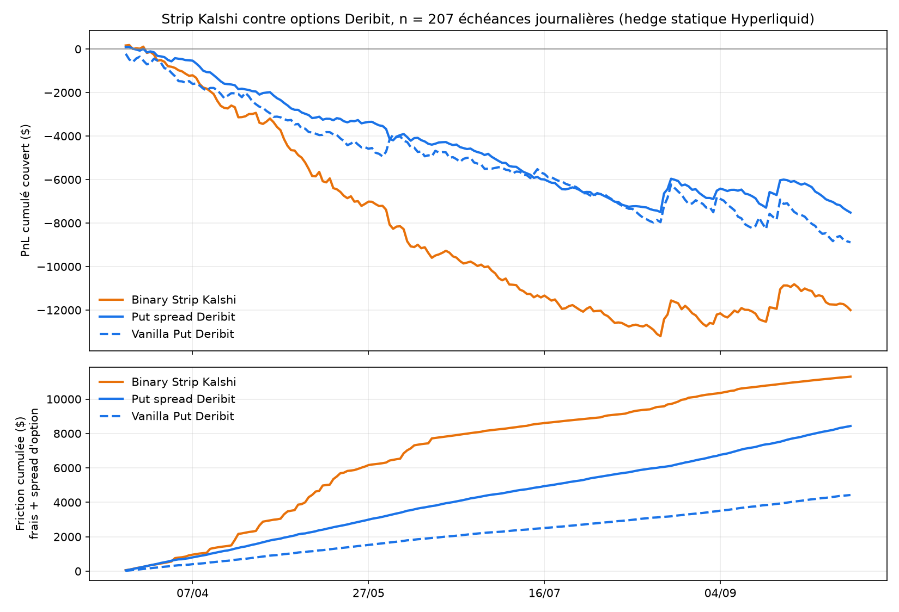

Quelques termes, utilisés partout ensuite.

| Terme | Sens |
|---|---|
| Binaire | Contrat qui paie 1 \$ si une condition est vraie à l'échéance (ici, BTC au-dessus d'un strike), 0 sinon |
| Delta, gamma | Sensibilité du prix de la binaire au spot, et sensibilité de ce delta au spot |
| Perp | Contrat perpétuel Hyperliquid sur BTC, sans échéance |
| Funding | Paiement horaire entre longs et shorts du perp |
| Taker, maker | Ordre qui consomme le carnet, ordre qui l'alimente |
| σ, IV, RV | Volatilité annualisée ; implicite (lue dans un prix) ; réalisée (mesurée sur les rendements) |
| DVOL | Indice de volatilité implicite à 30 jours de Deribit |
| T0, T1 | Entrée et sortie d'un backtest journalier |

## 1. Couverture d'une binaire Polymarket

La question : combien coûte, en frictions, la neutralité delta d'une binaire à échéance courte, comparée au risque qu'on garde en couvrant une seule fois ?

### Le modèle

Binaire cash-or-nothing de payoff 1 \$, taux nul (le perp est marginé en USDC), temps en années sur une base 24/7.


```math
V = N(d_2), \qquad \Delta = \frac{\varphi(d_2)}{S\ \sigma\sqrt T}, \qquad h = -\ Q\ \Delta \ \text{BTC}
```


avec $`d_2 = \dfrac{\ln(S/K) - \tfrac12\sigma^2 T}{\sigma\sqrt T}`$. Δ et Γ sont vérifiés contre des différences finies centrées sur 16 605 points (erreur relative max $`5\cdot10^{-4}`$ pour Δ), voir [docs/math_review.md](docs/math_review.md).

Trois sources de σ sont journalisées à chaque valorisation du portefeuille. La σ implicite est inversée de $`N(d_2)`$ par Brent. Pour S < K, le prix n'est pas monotone en σ et plafonne sous 0,5 : si le mid dépasse ce plafond, il n'existe pas de solution. La dernière σ valide sert alors 300 s, puis la source repasse sur la DVOL de Deribit. La troisième source est une EWMA de la volatilité réalisée des mids Hyperliquid, sur une grille de 60 s. Au tick, le bruit de microstructure la gonfle de +18 % à 1 bp de bruit, et de +226 % à 5 bp.

### Résultats

Marché `bitcoin-above-84k-on-october-12-2026` : K = 84 000 \$, résolution sur la bougie 1 min Binance BTC/USDT de 12:00 ET. Achat de 1 000 parts YES à 0,3562, soit une prime de 356,22 \$. Les deux stratégies tournent sur le même flux, enregistré le 12/10/2026 à partir de 08:37 UTC. Chiffres en dollars, frais déduits au fill.

| Stratégie | Jambe PM | Jambe HL | Frais PM | Frais HL | Funding | PnL | σ(Δ net) | Fills HL |
|---|---|---|---|---|---|---|---|---|
| statique | −141,22 | +82,44 | 16,05 | 5,70 | −0,37 | −80,17 | 0,053 BTC | 40 (maker, 1 ordre) |
| dynamique | −141,22 | +78,41 | 16,05 | 127,76 | −0,34 | −206,28 | 0,009 BTC | 798 (taker) |

La fenêtre couvre 41 minutes de flux live (08:37 → 09:19:51 UTC), rejouées à l'identique. Sur les 87 minutes complètes, jusqu'à 10:04 UTC, le statique finit à −74,80 \$ et le dynamique à −254,80 \$ (1 548 fills HL, 181,43 \$ de frais HL). L'écart se creuse, les conclusions ne changent pas.

Presque tout l'écart (122 \$ sur 126) correspond aux frais taker Hyperliquid : 798 rebalancements pour 284 k\$ de notionnel, soit 36 % de la prime payée.

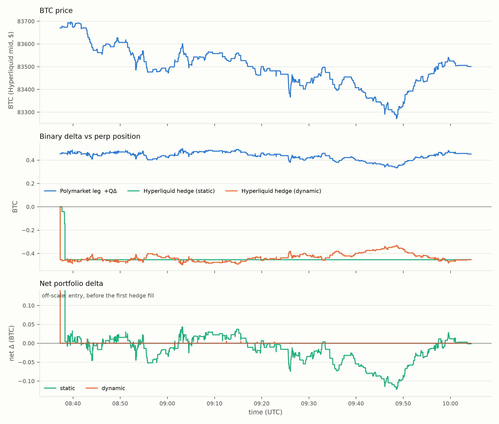

Le replay étant déterministe, `python run.py sweep` rejoue la même session avec d'autres seuils et d'autres sources de σ.

| Seuil dynamique | σ | Rebal. | Notionnel HL | Frais HL | PnL | σ(Δ net) |
|---|---|---|---|---|---|---|
| 0,0002 BTC (≈ 10 \$, minimum) | implicite | 798 | 283 902 \$ | 127,76 | −206,28 | 0,0093 |
| 0,005 BTC | implicite | 360 | 251 658 \$ | 113,25 | −189,56 | 0,0095 |
| 0,01 BTC | implicite | 136 | 168 710 \$ | 75,92 | −150,51 | 0,0104 |
| 0,02 BTC | implicite | 34 | 100 361 \$ | 45,16 | −116,98 | 0,0125 |
| 0,05 BTC | implicite | 3 | 46 875 \$ | 21,09 | −93,71 | 0,0190 |
| minimum | DVOL | 576 | 59 963 \$ | 26,98 | −112,49 | 0,0083 |
| minimum | EWMA 60 s | 626 | 277 755 \$ | 124,99 | −164,02 | 0,0093 |
| statique | — | 0 | 38 003 \$ | 5,70 | −80,17 | 0,0526 |

Au seuil minimal, couvrir avec la DVOL plutôt qu'avec la σ implicite coûte 4,7 fois moins de frais, sans plus de risque résiduel. La σ implicite est inversée d'un prix qui bouge par pas de 1 centime : chaque tick du YES fait bouger σ, donc Δ, donc un ordre. Ce n'est pas du risque à couvrir, c'est du bruit de discrétisation payé en taker.

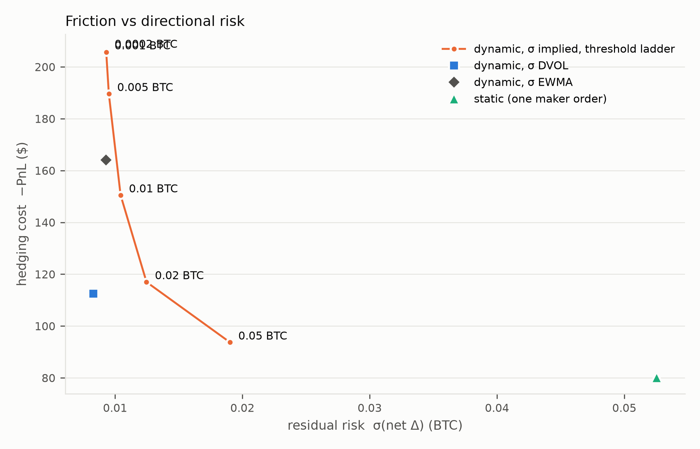

### Pourquoi la dynamique perd

Les frais. Un rebalancement taker paie 4,5 bp du notionnel, plus le demi-spread. À la monnaie, le notionnel de la couverture vaut $`|h|\ S = Q\ \varphi(d_2)/(\sigma\sqrt T)`$. Il ne dépend pas de S et croît en $`T^{-1/2}`$ :

| T restant | Δ par part | Couverture | Notionnel |
|---|---|---|---|
| 6 h | 2,77·10⁻⁴ BTC | −0,277 BTC | 30 486 \$ |
| 2 h | 4,80·10⁻⁴ BTC | −0,480 BTC | 52 805 \$ |
| 30 min | 9,60·10⁻⁴ BTC | −0,960 BTC | 105 610 \$ |

On couvre donc 30 à 100 fois le payoff maximal (1 000 \$) pour protéger une prime de 356 \$. Chaque aller-retour taker coûte quelques dollars, et le seuil minimal en déclenche des centaines par heure.

Le gamma. Il vaut $`\Gamma = -\varphi(d_2)\ d_1 / (S^2\sigma^2 T)`$, diverge en $`1/T`$ près du strike et change de signe quand S traverse K. Près de l'échéance, un mouvement de quelques dizaines de dollars inverse la couverture : on achète en haut, on vend en bas, et on paie le spread dans les deux sens. D'où le kill-switch, qui clôture tout et annule les ordres 2 h avant l'échéance.

Le theta et le vega ne se couvrent pas en delta. Sur la fenêtre, la jambe Polymarket perd 141 \$ et la couverture n'en récupère que 78 à 82 \$. Le reste vient du spread et des frais d'entrée, du theta d'une binaire hors de la monnaie, et de la baisse de la σ implicite (0,33 → 0,28).

### Frais et microstructure

- Hyperliquid : lot BTC de 10⁻⁵, notionnel minimal de 10 \$, frais de palier de 0 à 1,5 bp maker et 4,5 bp taker, funding horaire. Le canal `l2Book` n'est poussé qu'environ toutes les 5 s. Le carnet est donc reconstruit en fusionnant le canal `bbo` (~6/s) avec la profondeur du dernier `l2Book`. Sans cette fusion, la couverture dynamique travaillait sur un prix vieux de 5 s.
- Polymarket : sur les marchés crypto, les ordres taker paient 0,07 × parts × p × (1 − p), arrondi à 5 décimales, et il n'y a pas de frais maker. Le carnet local est reconstruit depuis `book` et `price_change`, puis contrôlé à chaque message contre le meilleur bid et ask publiés.
- Exécution simulée : un ordre taker balaie le carnet niveau par niveau, avec un frais par niveau, car le frais Polymarket n'est pas linéaire en p. Un ordre maker n'est rempli que par un trade agresseur qui traverse strictement son prix. Un carnet déjà balayé n'est jamais rebalayé avant la mise à jour suivante.
- Audit : `python -m risk.audit` recalcule chaque frais depuis le journal et vérifie la décomposition du PnL, l'absence de fill après le kill-switch et la mise à plat finale.

Les sources et leurs URL sont dans [docs/microstructure_review.md](docs/microstructure_review.md), l'audit des frais dans [docs/fee_audit.md](docs/fee_audit.md). Les messages capturés en live servent de fixtures dans `tests/fixtures/`.

### Bilan de la session

La couverture dynamique paie 127,76 \$ de frais taker sur une prime de 356,22 \$ et perd quand même davantage que la statique. La statique coûte moins, mais laisse un risque résiduel 5,7 fois plus grand.

## 2. Un trade Kalshi : strike unique contre strip

La question : à budget de prime égal, un strip de NO sur plusieurs strikes réduit-il le risque d'une position courte sur binaire, et à quel prix en frais ?

### Le trade

Ouverture le 10/10/2026 à 17:00 EDT d'un long NO sur `KXBTCD-26OCT1117` (« BTC au-dessus de K le 11/10 à 17:00 EDT »), couvert en statique par un long perp Hyperliquid de taille −Δ. Clôture le 11/10 à 17:00 EDT. Règlement sur la moyenne des 60 dernières secondes du BRTI de CF Benchmarks : 83 543,76 \$. Budget de prime : 510 \$ dans les deux cas.

| | Strike unique | Binary strip |
|---|---|---|
| Strikes | 1 × K = 83 000 (NO à 0,51) | 9 × K = 82 000 → 84 000, pas de 250 \$ |
| Contrats | 1 000 | 113 par strike, poids uniformes en ΔK |
| Jambe Kalshi (prime, payoff, frais) | −527,50 | −297,70 |
| Long perp HL (taille −Δ_total, σ DVOL) | 0,2494 BTC, +162,36 | 0,2344 BTC, +152,59 |
| Frais Kalshi (taker, ceil par ordre) | 17,50 | 12,94 (9 pattes) |
| Frais HL + funding | 18,70 − 1,52 | 17,58 − 1,43 |
| PnL net | −382,32 | −161,25 |
| σ du PnL couvert, horaire, avant la cassure de 15:00 | 37,5 \$ | 12,3 \$ |
| Pire variation horaire | 170 \$ | 118 \$ |

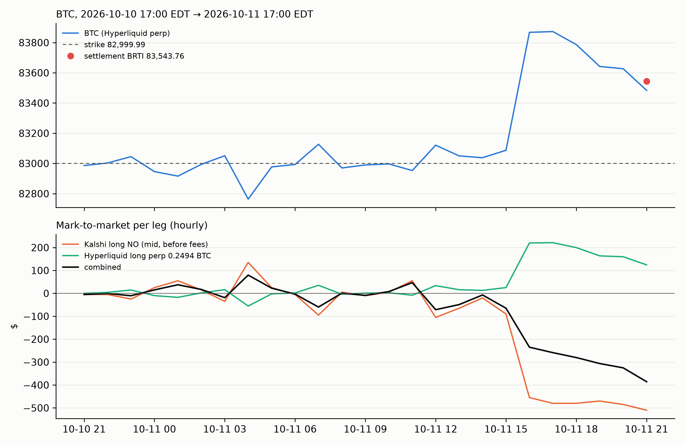

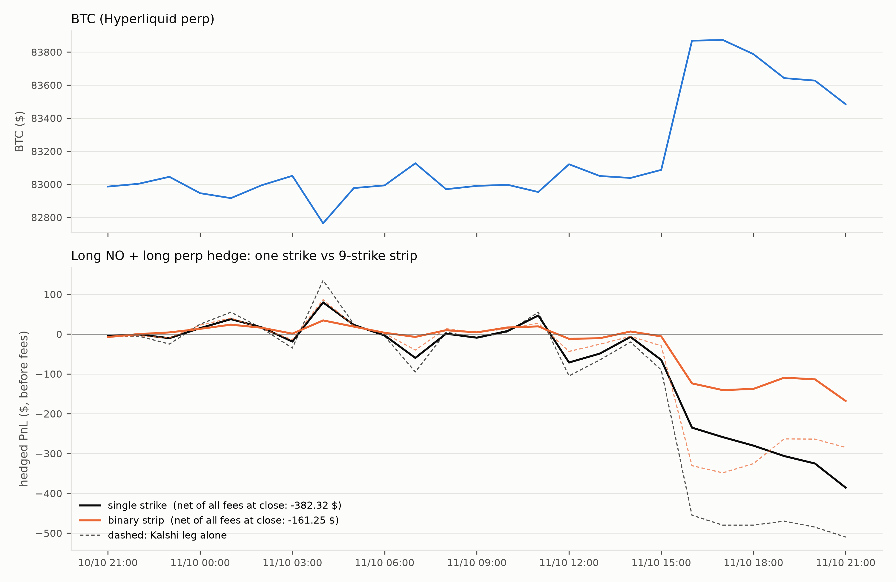

### Pourquoi un strip

Une binaire NO est la dérivée d'un put par rapport au strike : $`(K-S_T)^+ = \int_0^{K} \mathbf 1\lbrace S_T\lt k\rbrace \ dk`$ (Breeden & Litzenberger, 1978 ; Carr & Madan, 1998). Un strip de n NO par strike, sur une grille de pas ΔK, réplique donc un put spread à n/ΔK unités. Son delta tend vers


```math
\Delta_{\text{strip}} \xrightarrow{\ \Delta K\to 0\ } \frac{n}{\Delta K}\Big[N\big(d_1(K_{\max})\big) - N\big(d_1(K_{\min})\big)\Big] \lt  0,
```


et son gamma est borné par $`0{,}4\ n/(\Delta K\ S\sigma\sqrt T)`$, au lieu de diverger en $`1/T`$ sur un strike unique. La pondération uniforme en ΔK est celle de la réplication. Une pondération gaussienne centrée sur le spot ne modifie les tailles que de 10 à 17 % et n'apporte rien. Détail dans [docs/strip_research_replication.md](docs/strip_research_replication.md) et [docs/strip_research_weights.md](docs/strip_research_weights.md).

### Résultats

Le frais Kalshi est quadratique, 0,07 n p (1 − p), maximal à p = 0,5. Le strip déplace des contrats vers des prix éloignés de 0,5, où le frais unitaire est plus faible. L'arrondi au centime supérieur, appliqué à chacune des 9 pattes, ne coûte que 0,03 \$ de plus. Au total, le strip paie 12,94 \$ de frais Kalshi contre 17,50 \$.

Le gain de +221 \$ n'est pas une économie de gamma. Il vient à 229,80 \$ de la jambe Kalshi : les NO à 83 750 et 84 000, au-dessus du règlement, ont payé 226 \$. Le perp donne −9,77 \$, et les frais HL avec le funding +1,03 \$.

Sous la probabilité implicite des prix d'entrée, les deux structures ont la même espérance : environ 503 à 505 \$ de payoff pour 510 \$ de prime, soit −20 à −22 \$ après frais. Si BTC avait fini à 82 000 \$, le strip aurait perdu davantage que le strike unique sur la jambe Kalshi.

Ce que le strip change, c'est la distribution. Avant la cassure de 15:00, l'écart-type horaire du PnL couvert passe de 37,5 \$ à 12,3 \$. Le gamma maximal, une heure avant l'échéance, est divisé par 4,3.

Sur ce trade, la σ pèse plus que la structure. Les deux couvertures utilisent la DVOL à 30 jours (36,8 %), alors que les σ implicites des strikes Kalshi tournaient autour de 19,5 % ce week-end-là. Avec la σ du marché, la couverture aurait été de 0,37 BTC au lieu de 0,23 BTC, et les PnL de −82,79 \$ pour le strip et −253,78 \$ pour le strike unique.

### Ce que le trade montre

Un trade ne valide rien. Il montre le mécanisme : le strip supprime l'effet falaise du gamma, sans changer l'espérance. Le test suivant porte sur 207 échéances.

## 3. Validation sur 207 échéances

La question : la réduction de variance du strip tient-elle sur plus d'un trade, et son PnL moyen diffère-t-il de celui du strike unique ?

### Méthode

207 échéances journalières KXBTCD, du 19/03 au 11/10/2026. Entrée J−1 17:00 EDT, sortie J 17:00 EDT, couverture statique en long perp. Le strike unique est ATM. Le strip couvre ±1 000 \$ : 9 pattes sur 177 jours, 5 pattes sur les 30 jours où Kalshi liste au pas de 500 \$. Deux σ de couverture : la DVOL, et la σ implicite médiane des strikes Kalshi. Tests appariés par jour, bootstrap à 10 000 tirages (graine fixe), test de Pitman-Morgan pour les variances. Avant la mi-avril, Deribit ne sert plus la DVOL à la minute : on prend la barre horaire qui clôture à T0. Détail, y compris par sous-période, dans [docs/multi_day_report.md](docs/multi_day_report.md).

### Résultats

| Structure, σ | Moyenne (\$) | Médiane (\$) | Écart-type (\$) | % jours gagnants |
|---|---|---|---|---|
| Strike unique, DVOL | −85,0 | −131,6 | 361,8 | 41,1 |
| Strike unique, σ Kalshi | −74,5 | −130,4 | 381,8 | 39,1 |
| Strip, DVOL | −58,0 | −70,3 | 186,0 | 31,9 |
| Strip, σ Kalshi | −53,6 | −66,2 | 200,9 | 29,5 |

| Comparaison (strip − strike unique) | Diff. moyenne (\$/jour) | p | IC 95 % | Ratio σ (IC 95 %) | p Pitman-Morgan |
|---|---|---|---|---|---|
| σ DVOL | 27,03 | 0,136 | [−8,58 ; 63,18] | 0,514 [0,436 ; 0,579] | < 0,001 |
| σ Kalshi | 20,88 | 0,255 | [−15,20 ; 57,35] | 0,526 [0,441 ; 0,584] | < 0,001 |

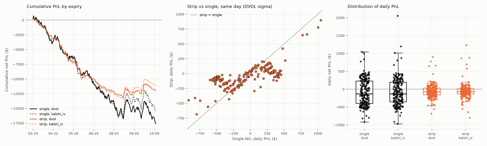

La variance du PnL tombe à 0,26 fois celle du strike unique avec la σ DVOL, et l'écart-type à 0,51 fois. Le résultat est le même avec la σ Kalshi.

### Robustesse

Sans les sept jours à plus de 5 % de variation (02/06, 19, 20 et 21/08, 03/09, 18/09, 21/09), le strip gagne +32,6 \$ (p = 0,080) et le ratio d'écarts-types tombe à 0,42. Sur les 177 jours à 9 pattes : +20,8 \$ (p = 0,28). Par sous-période, avec la σ DVOL : mars-mai −2,3 \$ (p = 0,94), juin-août +32,9 \$ (p = 0,22), septembre-octobre +66,8 \$ (p = 0,16). Le choix de la σ change peu le PnL moyen : la σ Kalshi ajoute +10,5 \$ au strike unique (p = 0,20) et +4,4 \$ au strip (p = 0,33).

### Ce que les 207 jours montrent

La dispersion du PnL journalier est divisée par deux, p < 0,001 sous les deux σ, et le résultat tient dans les trois sous-périodes. L'écart de PnL moyen, lui, n'est significatif dans aucune spécification : +27,0 \$ par jour, avec un intervalle qui contient zéro. Les quatre moyennes sont négatives (−54 à −85 \$, erreurs-types de 13 à 27 \$), et les médianes aussi. La structure se justifie par le risque, pas par l'espérance.

Les chiffres de tête n'excluent aucun jour. L'exclusion des sept jours extrêmes est un contrôle a posteriori. Le passage à 207 jours a fait disparaître la significativité obtenue sur les 90 premiers jours en retirant ces jours (p = 0,035 dans cette version antérieure de l'analyse) : elle tenait à l'échantillon. Limite : une seule période de sept mois, et des tests quotidiens qui ne sont pas indépendants si la volatilité est autocorrélée.

## 4. Strip Kalshi contre options Deribit

La question : pour le même payoff, une couverture synthétique sur un marché de prédiction a-t-elle un sens face à une option institutionnelle ?

### Méthode

Même fenêtre que le strip : T0 = J−1 21:00 UTC, T1 = J 21:00 UTC. L'option Deribit est la journalière J+1 08:00 UTC, ouverte à T0 et valorisée à T1, avec 11 h restantes. L'API publique ne garde ni carnet ni grecs historiques. Le smile est donc reconstruit à partir des trades des 3 h précédant T, en log-moneyness, et l'on ajoute le demi-spread mesuré sur ces trades, sans look-ahead. La quantité est n/p BTC, p étant le pas des strikes Kalshi. La couverture reste statique sur Hyperliquid, avec les fundings réels. Barème des frais : [docs/deribit_friction.md](docs/deribit_friction.md). Chiffres complets : [docs/deribit_benchmark_report.md](docs/deribit_benchmark_report.md).

### Résultats

| PnL couvert par jour (\$) | Moyenne | Médiane | Écart-type | Friction d'option par jour |
|---|---|---|---|---|
| Strip binaire Kalshi | −58,0 | −70,3 | 186,0 | 54,6 \$ (frais 13,7 + spread 40,9) |
| Put spread Deribit | −36,3 | −50,2 | 133,0 | 40,7 \$ (frais 29,8 + spread 11,0) |
| Put vanille Deribit | −42,9 | −78,0 | 175,9 | 21,4 \$ |

Put spread moins strip : +21,7 \$ par jour (p = 0,002, IC [7,9 ; 35,6]), avec un rapport d'écarts-types de 0,71 (Pitman-Morgan, p < 0,001). Put vanille moins strip : +15,0 \$ (p = 0,29), sans différence significative.

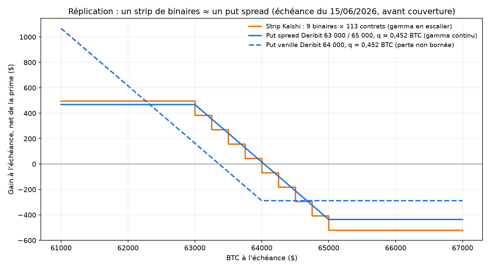

### Friction et liquidité

Les deux frictions ont des profils opposés. Kalshi paie ses frais une seule fois, puisque le contrat va au règlement, mais traverse un spread large : 75 % de sa friction. Deribit a un spread serré, mais paie min(0,03 % du sous-jacent ; 12,5 % de la prime) par patte, à l'entrée et à la sortie. Les frais font 73 % de sa friction. Une remise combo, que je n'ai pas pu confirmer sur la page officielle, ramènerait la friction du put spread à 29,0 \$ par jour.

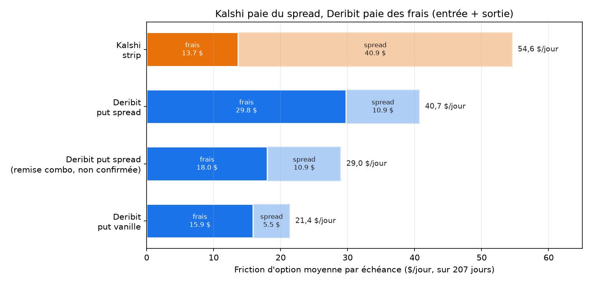

L'avantage Deribit suit le spread Kalshi. La régression de l'écart quotidien sur ce spread donne écart = −14,5 + 0,88 × spread, avec une corrélation de 0,61. Les deux structures s'égalisent vers 16 \$ de spread par jour.

| Période | n | Put spread − strip (\$/jour) | p | Spread Kalshi par jour (\$) |
|---|---|---|---|---|
| Mars-mai | 74 | 49,6 | < 0,001 | 71,4 |
| Juin-août | 92 | 24,2 | 0,009 | 29,7 |
| Septembre-octobre | 41 | −34,5 | 0,008 | 11,1 |

Sans les trois jours de septembre à plus de 5 % de variation, l'écart de septembre-octobre reste à −32,0 \$ (p = 0,012, n = 38). La largeur de la grille Deribit n'explique rien : sa corrélation avec l'écart de PnL est de 0,01.

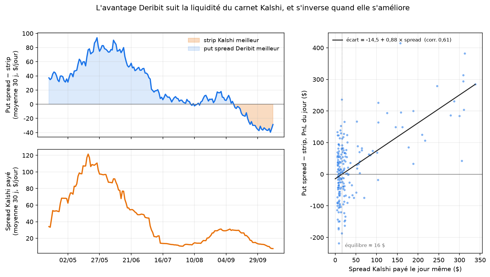

### Où se joue l'écart

Sur sept mois, une option institutionnelle reste le meilleur outil pour ce payoff : moins de friction, moins de variance. L'écart vient de la liquidité, pas de la structure. Il tient aux deux tiers à la friction d'option, surtout au spread du carnet Kalshi. Quand ce spread tombe à 11,1 \$ par jour, le strip devient meilleur.

Un marché de prédiction paie un coût de liquidité qui baisse avec la profondeur du carnet. Deribit paie un frais proportionnel au nominal, qui ne baisse pas. Le strip garde donc un sens si le carnet Kalshi est profond, ou pour une échéance que Deribit ne propose pas : ses options expirent à 08:00 UTC, et non à 17:00 EDT. Le verdict repose sur un seul épisode de resserrement.

Le put spread étant acheté, sa perte maximale est son débit net, 487 \$ en médiane, à comparer aux 510 \$ du budget Kalshi. Le perp porte un nominal médian de 16,4 k\$.

## 5. Diagnostics : gamma, IV contre RV, funding

La question : d'où vient le coût de la couverture, et quel poste pèse le plus, le gamma, la prime de volatilité ou le funding ?

### Gamma, sur le jour le plus volatil

Le 21/09/2026, BTC monte de 7,33 % entre T0 et T1. C'est le maximum de |S1/S0 − 1| sur les 207 jours. Le hedge tenu est statique et long : 0,264 BTC pour le strike unique, 0,240 pour le strip. Un NO long perd quand BTC monte, son delta est donc négatif, et le perp longue le compense.

Un rebalancement horaire aurait suivi un autre chemin. Pendant 11 h, BTC reste collé au strike ATM, et le delta grossit jusqu'à 0,30 BTC. À l'heure 12, BTC franchit la borne haute du strip, et le delta tombe à zéro en une heure. C'est la falaise de gamma. Le statique, lui, garde son long pendant toute la hausse, et c'est ce long qui compense la perte du NO.

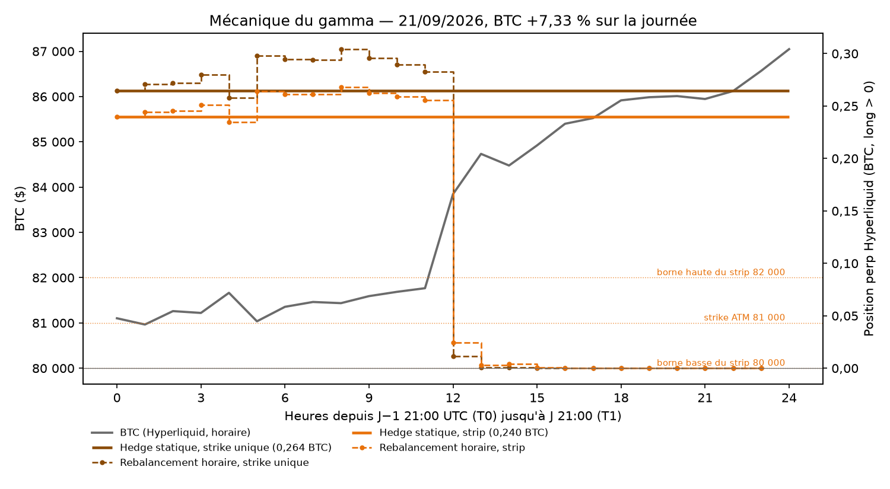

### IV contre RV

L'IV est la DVOL connue à T0. La RV est l'écart-type des 24 rendements log horaires Hyperliquid de [T0, T1), annualisé. En moyenne, l'IV vaut 40,3 % contre 34,3 % pour la RV, soit +6,0 points (+8,4 en médiane). L'IV dépasse la RV 71 % des jours. Les exceptions sont les journées de rupture (début juin, fin juin, fin août), où la RV dépasse 100 %.

La vol se paie trop cher en moyenne. C'est la perte structurelle d'un acheteur d'optionalité, et c'est le cas du long NO couvert.

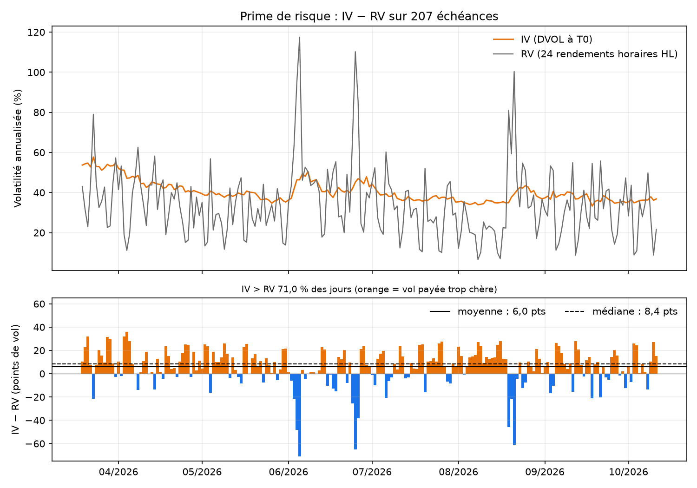

### Funding

Le funding Hyperliquid est positif 80 % des heures, soit 5,7 %/an en moyenne. Tenir le hedge long coûte donc chaque jour.

| Hedge | Funding cumulé sur 207 jours | Taille moyenne |
|---|---|---|
| Strike unique Kalshi | −643,26 \$ | 0,269 BTC |
| Strip Kalshi | −580,37 \$ | 0,242 BTC |
| Put spread Deribit | −568,72 \$ | 0,241 BTC |
| Put Deribit | −504,33 \$ | 0,216 BTC |

Les écarts suivent la taille du hedge. Le funding coûte environ 3 \$ par jour, contre 21 à 55 \$ de friction d'option.

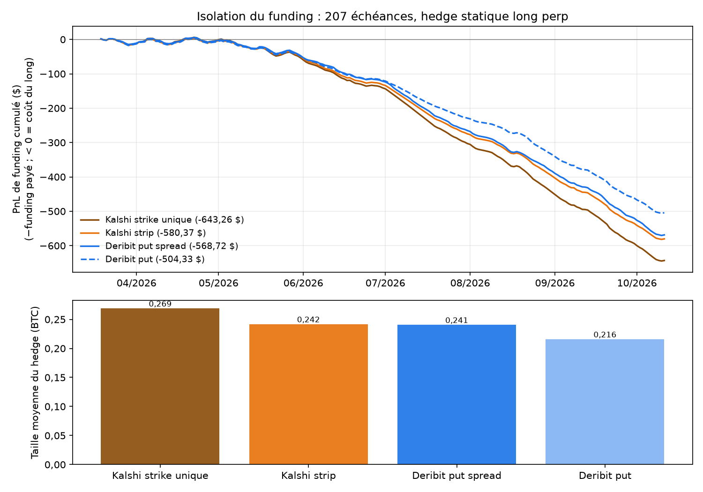

Contrôles : le cumul final de chaque courbe égale au centime la somme des `funding_paid` du journal. Un recalcul indépendant depuis les prints bruts (24 par jour) donne un écart maximal de 2e-15 \$. L'axe de position est signé, sans valeur absolue, et la direction est vérifiée. La RV se limite aux 24 bougies de [T0, T1) : la 25ᵉ bougie du cache, qui se clôture une heure après la sortie, est exclue.

## Reproduire

Python 3.12. Depuis la racine du projet, `pip install -e .` installe les dépendances déclarées dans `pyproject.toml`.

Les caches bruts de l'API (environ 1 Go) et l'enregistrement brut de la session live ne sont pas versionnés. Les backtests retéléchargent leurs entrées ; `run.py live` produit un nouvel enregistrement, sur lequel `replay` et `sweep` tournent.

```bash
# Moteur : enregistrement, replay, sweep, audit, figures
python run.py live --hours 6 --slug bitcoin-above-84k-on-october-12-2026
python run.py replay data/raw_<run>.jsonl
python run.py sweep data/raw_<run>.jsonl --thresholds 0.0002,0.005,0.01,0.02,0.05
python -m risk.audit data/journal_<run>.jsonl --final
python -m reports.plot data/journal_<run>.jsonl --strike 84000 --sweep data/sweep_<run>.csv

# Kalshi : un trade, puis le strip
python -m backtest.kalshi_one_trade
python -m backtest.kalshi_strip_trade --n-strikes 9 --budget 510 --weights uniform
python -m reports.plot --kalshi-compare data/kalshi_one_trade data/kalshi_strip_trade

# 207 échéances : une date, puis le regroupement en data/kalshi_multi/results.csv, puis le rapport
python -m backtest.multi_day --date 2026-10-11
python -m backtest.multi_day --collect
python -m reports.multi_day

# Deribit et diagnostics
python -m backtest.deribit_benchmark --all
python -m backtest.deribit_benchmark --collect
python -m reports.deribit_compare
python -m reports.presentation
python -m reports.diagnostics
```

Sur la session publiée ici, le replay a reproduit le journal live octet pour octet (11 352 lignes identiques).

## Organisation du code

| Dossier | Contenu |
|---|---|
| `api/` | Clients WebSocket asyncio (Hyperliquid, Polymarket CLOB, Deribit DVOL), dataclasses figées, enregistreur JSONL et replay |
| `core/` | `math_engine.py` : prix, Δ, Γ, σ implicite, EWMA |
| `strategies/` | `HedgeStrategy` (kill-switch, entrée, décision), `StaticHedger`, `DynamicHedger` |
| `risk/` | Kill-switch à T−2 h, barèmes de frais, audit du journal |
| `sim/` | Exécution simulée (balayage de carnet, fills maker), ledger, moteur événementiel |
| `backtest/` | Kalshi (strike unique, strip, 207 jours) et benchmark d'options Deribit |
| `reports/` | Figures et rapports : moteur, frontière, 207 jours, Deribit, diagnostics |
| `tests/` | Tests `pytest` (164) et fixtures de messages capturés en live |
| `run.py` | Point d'entrée : `live`, `replay`, `sweep` |

Le code passe `mypy --strict` (50 fichiers, tests compris) et `ruff check`. `pip install -e .[dev]` ajoute `mypy` et `pytest`.

## Limites

- Pas d'impact de marché. Le carnet n'est pas déplacé par nos ordres : au seuil minimal, la dynamique traiterait 284 k\$ en 41 minutes sans bouger le prix.
- File d'attente maker ignorée. Un ordre maker est rempli dès qu'un trade traverse son prix, sans tenir compte des ordres placés devant lui.
- Risque de base non mesuré. La couverture se fait sur le perp Hyperliquid, alors que le marché se résout sur Binance spot, et la position n'est jamais tenue jusqu'à la résolution.
- Une seule session live, de 41 minutes de flux. La frontière friction/risque est robuste dans sa forme, pas dans ses chiffres.
- Prix de sortie Deribit modélisé. Il vient d'un smile reconstruit à partir de trades jusqu'à 3 h avant T, alors que Kalshi se règle au prix réel.
- Une seule période de sept mois, avec des moyennes tirées par quelques jours de forte variation.
